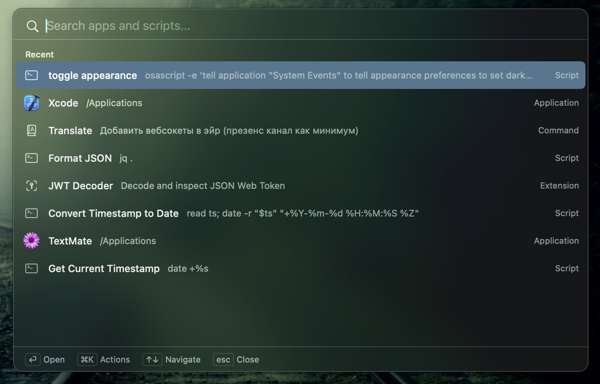
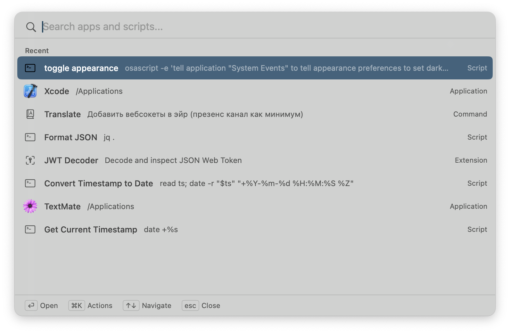
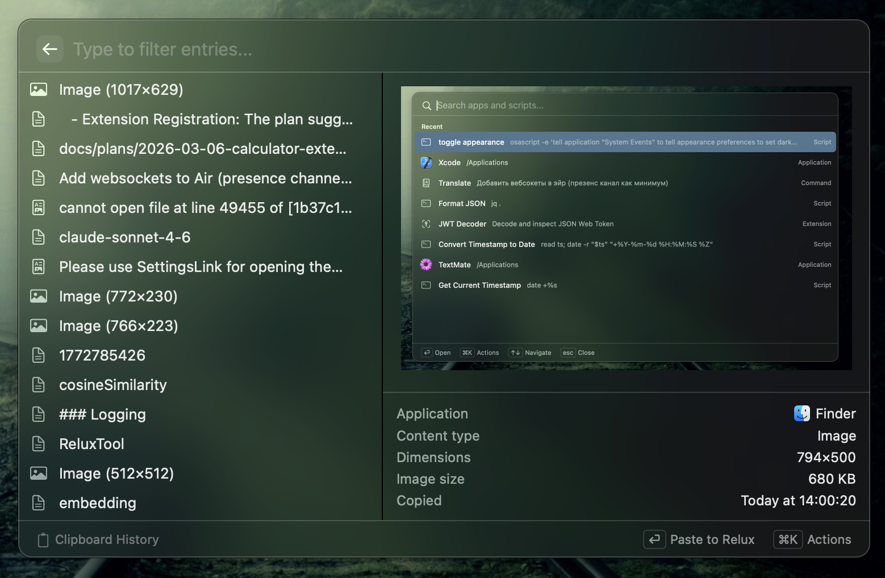
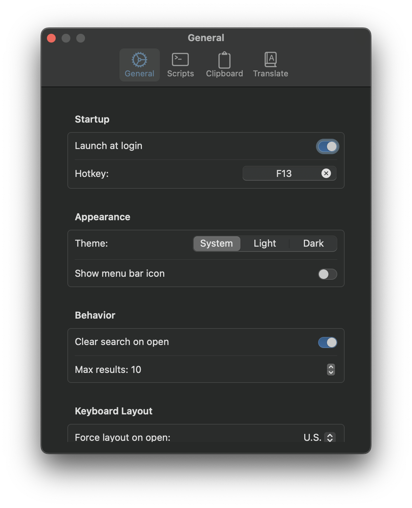
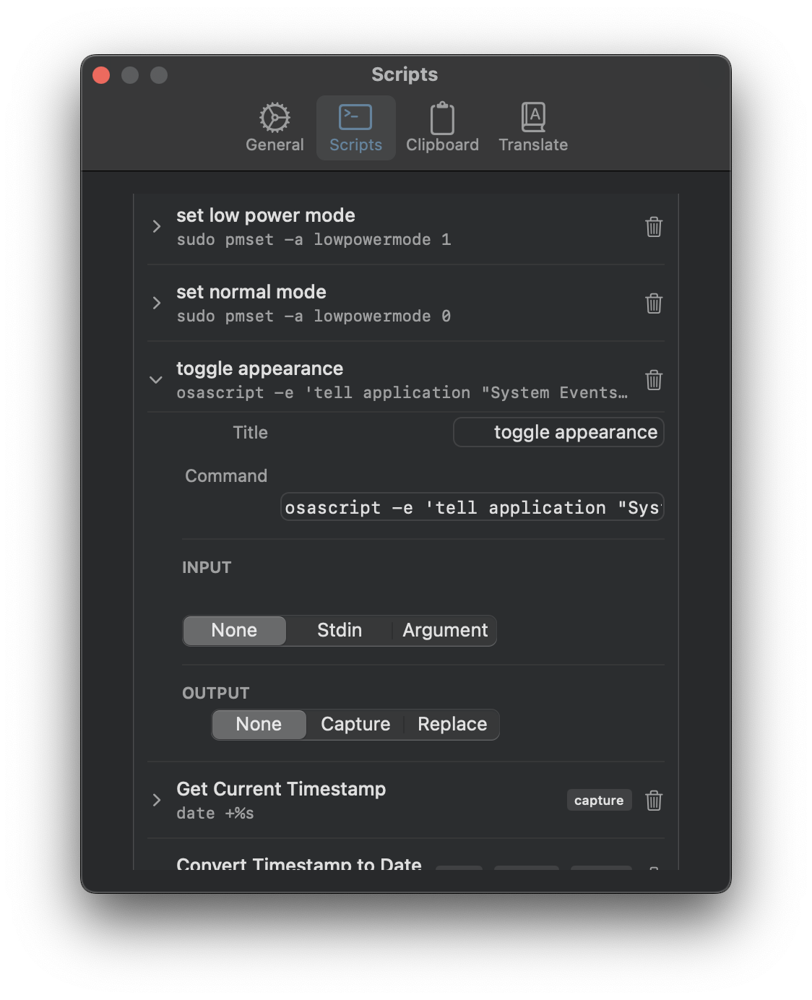
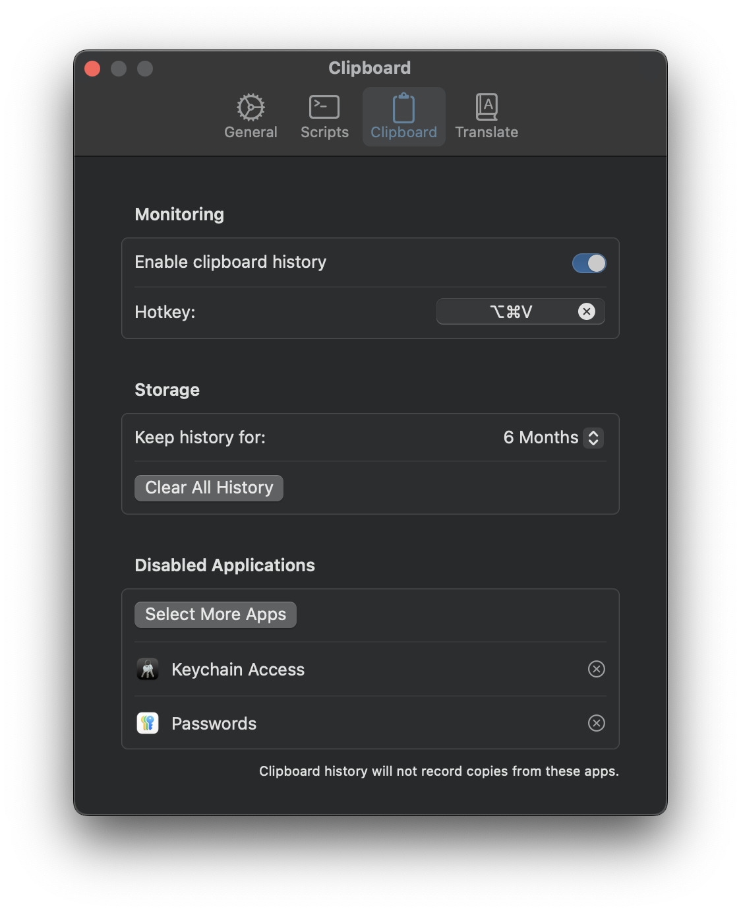
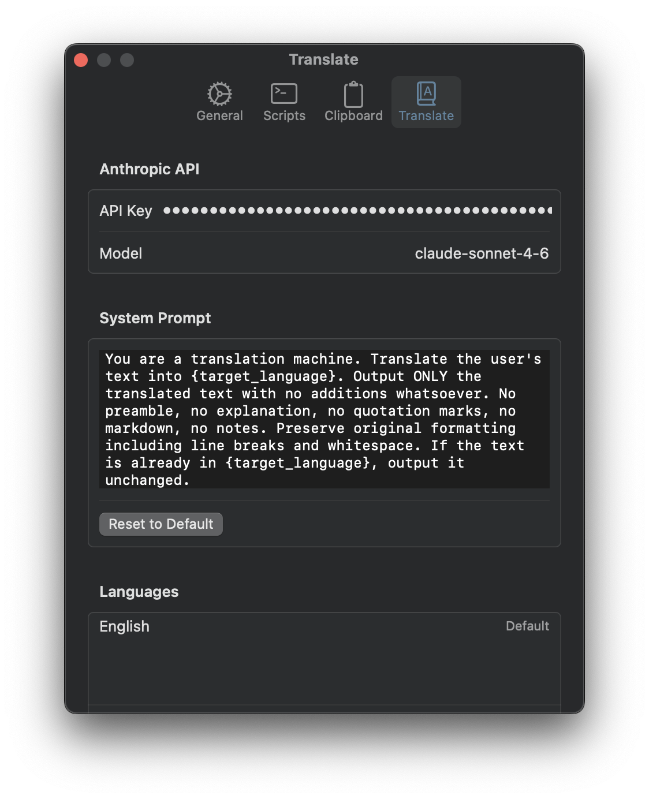

# Relux

A macOS menu-bar utility that puts app launching, clipboard history, translation, and more behind a single hotkey.

## Screenshots

<table>
  <tr>
    <td></td>
    <td></td>
  </tr>
  <tr>
    <td align="center"><em>Search overlay — dark</em></td>
    <td align="center"><em>Search overlay — light</em></td>
  </tr>
  <tr>
    <td></td>
    <td></td>
  </tr>
  <tr>
    <td align="center"><em>Clipboard history</em></td>
    <td></td>
  </tr>
  <tr>
    <th colspan="2">Settings</th>
  </tr>
  <tr>
    <td></td>
    <td></td>
  </tr>
  <tr>
    <td align="center"><em>General</em></td>
    <td align="center"><em>Scripts</em></td>
  </tr>
  <tr>
    <td></td>
    <td></td>
  </tr>
  <tr>
    <td align="center"><em>Clipboard</em></td>
    <td align="center"><em>Translate</em></td>
  </tr>
</table>

## Features

- **App launcher** — fuzzy search across installed applications; search paths configurable in Settings
- **System Settings** — search and open macOS System Settings categories directly (Wi-Fi, Keyboard, Privacy, etc.)
- **Clipboard history** — searchable SQLite-backed history, paste back with `Opt+Cmd+V` by default. Confidential copies (passwords, OTPs) are automatically ignored via `org.nspasteboard.ConcealedType`, `TransientType`, and `AutoGeneratedType` conventions. Per-app exclusions configurable in Settings.
- **Translator** — select any text, trigger the overlay, pick Translate from quick links; streams translation via Anthropic API (requires API key in Settings)
- **Calculator** — inline math evaluation with currency conversion (rates fetched daily from ECB)
- **Web search** — fall through to DuckDuckGo
- **Custom scripts** — shell scripts that can read selected text and write back to the panel, replace the selection, or show a toast
- **JWT decoder** — decode a pasted or captured token into header and payload panels
- **Gesture shortcuts** — trackpad gestures bound to Mission Control, app Exposé, show desktop, lock screen, space switching
- **Volume HUD** — optional CoreAudio-driven volume overlay (off by default)

## Install

```bash
brew tap tectiv3/relux
brew install --cask relux
```

Or download the latest `.dmg` from [GitHub Releases](https://github.com/tectiv3/relux/releases). The app is signed and notarized by Apple.

## Requirements (building from source)

- macOS 15+ (`deploymentTarget` in `project.yml`)
- Xcode 16+
- [XcodeGen](https://github.com/yonaskolb/XcodeGen) (`brew install xcodegen`)

## Build & Run

```bash
make generate   # xcodegen generate — required after adding files or changing targets
make build      # CLI build; plain xcodebuild fails on this toolchain
open Relux.xcodeproj  # or build and run from Xcode (⌘R)

# Tests. The `test` action fails here (Pseudo Terminal Setup Error, no free
# ptys), so after `make build` run the built bundle directly:
DD=$(xcodebuild -project Relux.xcodeproj -scheme Relux -configuration Debug -showBuildSettings 2>/dev/null | awk -F'= ' '/ BUILT_PRODUCTS_DIR/{print $2; exit}'); xcrun xctest "$DD/ReluxTests.xctest"
```

## Usage

| Shortcut | Action |
|---|---|
| `Option+Space` | Open search overlay |
| `Opt+Cmd+V` | Open clipboard history |
| `Cmd+K` | Actions overlay for the selected result |
| `Esc` / click outside | Dismiss |

All shortcuts are configurable in Settings. Selection-aware items (translate, scripts with an input mode, JWT) appear when text is selected in the frontmost app before opening the overlay.

> **Tip:** For the best experience, rebind the overlay shortcut to Caps Lock or another dedicated key so it's always one tap away.

## Architecture

```
ReluxApp / AppDelegate (menu bar item, floating NSPanel)
  → AppState (@MainActor @Observable)
    → Search/      AppSearcher, SystemSettingsSearcher, ScriptSearcher, FrecencyTracker
    → Store/       ClipboardStore (SQLite)
    → Clipboard/   ClipboardMonitor, PasteService
    → Translate/   AnthropicService, TranslateStore (SQLite)
    → Calculator/  CalculatorService, ExchangeRateCache
    → JWT/, Gestures/, VolumeHUD/, SpaceSwitch/
    → Extensions/  ExtensionRegistry (string ids + closures, UserDefaults toggles)
    → ReluxCore (framework)  SearchItem, FuzzyMatch, ResultGrouping, Formatting, JWTParser

Tests/ReluxTests (host-free, XCTest, against ReluxCore only)
```

`ReluxCore` holds the pure logic — `SearchItem`, fuzzy matching, result grouping, formatting, JWT parsing — with no AppKit, SwiftUI, or SQLite dependency, so it can be tested without launching the app. `Tests/ReluxTests` runs host-free against that framework (41 tests in 4 suites).

Features are toggled through `ExtensionRegistry`, which is a small registry of string ids registered inline in `AppState.setup()` — new features are added as source files plus a `PanelMode` case, not through a plugin protocol.
